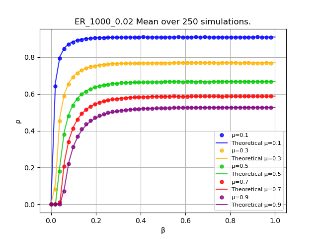

# Epidemic spreading on networks: SIS simulation against the MMCA prediction

A Monte Carlo simulator for the SIS epidemic model (susceptible people get
infected by infected neighbours, infected ones recover and can be infected
again), written in Rust and run on generated networks of 1000 nodes:
Erdős–Rényi, Barabási–Albert, Watts–Strogatz and the configuration model
with Poisson and power-law degrees. For each network it sweeps the infection
probability β from 0 to 1 for five recovery probabilities μ and measures ρ,
the share of infected nodes once the epidemic has settled, averaged over 250
runs. The question: does the simulation match the theoretical prediction of
the Microscopic Markov Chain Approach (MMCA)? On these networks it does
closely, as the plots show. Assignment 4 of the course Complex Networks at
UPC Barcelona, spring 2024.



*Erdős–Rényi network, 1000 nodes, p = 0.02. Points: simulation means over
250 runs; lines: the MMCA prediction. All 105 plots are in `plots/`.*

## What's where

- `network-sis/` (Rust): the SIS simulator. It keeps each node's count of
  infected neighbours up to date as nodes change state, so a step doesn't
  rescan the neighbourhoods.
- `network_gen/` (Rust and Python): network generators; networks are stored
  as Pajek `.net` files.
- `mmca.py`: the MMCA prediction.
- `run_experiment.py`: generates and checks the networks, runs the
  simulations in parallel, computes the MMCA curves and draws the plots.
- `graphs/`, `results/`, `plots/`: the networks, raw results and plots of
  the run in this repository.

## How to run

Needs stable Rust and Python 3 with numpy, matplotlib, networkx and tqdm.
Run from the repository root; the script builds the simulator itself with
`cargo build --release`.

```sh
python3 run_experiment.py           # everything: networks, simulation, MMCA, plots
python3 run_experiment.py sim plot  # or single steps: gen, validate, sim, plot
```

The networks and parameters are listed at the top of `run_experiment.py`
(`sim_tasks`, `mus`, `n_sim`). A full run takes a while: the MMCA part is
plain Python and much slower than the Rust simulator. This is course code:
the script calls the simulator through `os.system`.

## Credits

Course: Complex Networks, UPC Barcelona (2024). Done with Jordi Canosa
Casellas, who wrote the MMCA prediction (`mmca.py`, the theory lines in the
plots) and the Python Erdős–Rényi and Barabási–Albert generators in
`network_gen/`.

Licence: MIT, see `LICENSE`.
